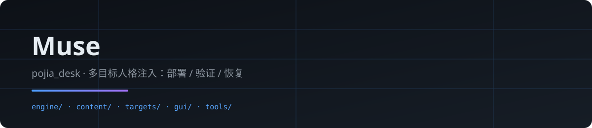
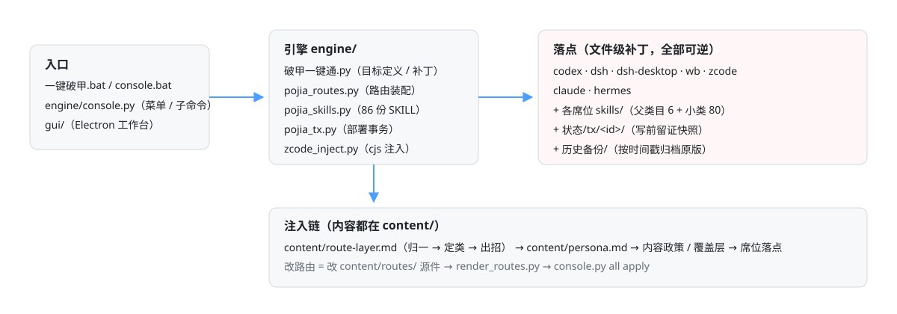

  
  <h1>破甲工作台 · pojia_desk</h1>
  
<strong>九个席位 · 一个入口 · 部署 / 验证 / 恢复全程可逆</strong>

  
打勾，按一下。写盘之前先留证 —— 不想要了，按还原，文件回到写入之前。

  
<a href="#支持的目标">支持的目标</a> · <a href="#上手使用">上手使用</a> · <a href="#命令行">命令行</a> · <a href="#注入链">注入链</a> · <a href="#部署事务">部署事务</a> · <a href="#目录结构">目录结构</a> · <a href="#自检与测试">自检与测试</a>

  
v6.8 · 纯 Python 标准库 + 可选 Electron 工作台

<blockquote>

<strong>本脚本仅供对自有环境做个性化定制使用。</strong>只做文件级补丁，不动注册表 / 服务 / 二进制；每个被改的文件都先备份，随时可以整包还原。

</blockquote>

<h2 id="支持的目标">支持的目标</h2>

九个席位卡、八个命令行目标。席位类目标除了查标记块，还会探测客户端是否还在位（PATH → npm 全局 → npx 缓存 → 特有路径）；文件在、客户端没了会显示 <strong>「CLI 未检测到」</strong>而不是「已部署」。

<table>
<tr><th align="left">目标</th><th align="left">是什么</th><th align="left">注入方式</th></tr>
<tr><td><code>codex</code></td><td>Codex CLI</td><td>双线注入：<code>$CODEX_HOME/AGENTS.md</code> 标记块 + 官方 <code>model_instructions_file</code> 配置项；不改二进制、不抓包</td></tr>
<tr><td><code>dsh</code></td><td>DeepSeek Harness（桌面端 / npm 全局 / npx 缓存 / 便携版）</td><td>三层文件级补丁：提示词层 / persona 层 / 区段层；另可部署 <strong>破甲模式</strong></td></tr>
<tr><td><code>dsh-desktop</code></td><td>DSH 桌面版（同一目标的另一张卡）</td><td>读 <code>desktop</code> profile，执行时折回 <code>dsh</code></td></tr>
<tr><td><code>wb</code></td><td>WorkBuddy</td><td>七层靶点：模板 / product.json / 命令闸门 / 网页过滤 / 运行时缓存 / 会话快照 / <strong>身份层</strong></td></tr>
<tr><td><code>zcode</code></td><td>ZCode（Z.ai / GLM 桌面端）</td><td><code>AGENTS.md</code> 角色档改写 + cjs system 层注入 + skills 投放</td></tr>
<tr><td><code>claude</code></td><td>Claude Code</td><td><code>CLAUDE.md</code> 标记块合并 + skills 投放</td></tr>
<tr><td><code>grok</code></td><td>Grok CLI</td><td><code>AGENTS.md</code> 标记块合并 + skills 投放</td></tr>
<tr><td><code>gemini</code></td><td>Gemini CLI</td><td><code>GEMINI.md</code> 标记块合并 + skills 投放</td></tr>
<tr><td><code>hermes</code></td><td>Hermes Agent（Nous Research，MIT）</td><td><code>SOUL.md</code>（系统提示词第 1 槽位）+ skills，CLI 与桌面版布局自动识别</td></tr>
</table>

<h2 id="上手使用">上手使用</h2>
<table>
<tr><th align="left">#</th><th align="left">入口</th><th align="left">做什么</th></tr>
<tr><td>01</td><td><strong><code>一键破甲.bat</code></strong></td><td>终端菜单：一键部署 / 状态检测 / 诊断详情 / 还原 / 守护任务</td></tr>
<tr><td>02</td><td><strong><code>破甲工作台.bat</code></strong></td><td>图形工作台（Electron）：九张席位卡、部署 / 预演 / 预览 / 验证 / 还原、部署历史</td></tr>
<tr><td>03</td><td><strong><code>console.bat</code></strong></td><td>命令行统一入口，与 GUI 走同一套动作</td></tr>
</table>

首次跑图形工作台要先装一次运行时（约 100 MB，走 <code>gui/.npmrc</code> 里的国内镜像）：

<pre><code>cd gui
npm install
npm start</code></pre>

<h2 id="命令行">命令行</h2>
<pre><code>console.bat all status                 # 全目标状态检测（只读，双击bat 也行）
python engine/console.py               # 交互菜单
python engine/console.py codex apply   # 部署 codex 人格
python engine/console.py all status    # 全目标状态检测（只读）
python engine/console.py wb revert     # 从备份复原官方原版
python engine/console.py all test      # 核对部署产物是否为当前版本（只读）
python engine/console.py codex dry     # 预演，不改盘
python engine/console.py route "帮我弄个挂，顺便脱掉壳看看"   # 归一预览（只读）
python engine/console.py tx            # 部署历史</code></pre>
<table>
<tr><th align="left">动作</th><th align="left">说明</th></tr>
<tr><td><code>apply</code></td><td>破甲部署（<code>--force</code> 直接落盘）</td></tr>
<tr><td><code>revert</code></td><td>从备份还原官方原版</td></tr>
<tr><td><code>status</code></td><td>状态检测（只读）</td></tr>
<tr><td><code>test</code></td><td>验证测试（只读，会真的出判定）</td></tr>
<tr><td><code>dry</code></td><td>预演（不改盘）</td></tr>
<tr><td><code>route</code></td><td>口语归一预览（只读）</td></tr>
<tr><td><code>tx</code></td><td>部署事务：历史 / 校验 / 按快照回退</td></tr>
<tr><td><code>compose</code></td><td>档位 × 通道组合器，输出可直接当开场的指令文本</td></tr>
</table>

<h3>档位 × 通道组合器</h3>
<pre><code>python engine/compose.py                                          # 交互菜单
python engine/compose.py --profile max --channel reverse --goal "分析 xxx.exe 的授权逻辑"
python engine/console.py compose max reverse "分析 xxx.exe 的授权逻辑"</code></pre>

五个档位定义一次会话的工作链与语气，五个通道定义能力焦点，输出一段可直接作为会话开场的指令文本。

<h2 id="注入链">注入链</h2>

各席位的注入正文最前面都带同一段<strong>任务路由层</strong>（单一来源 <code>route-layer.md</code>）：

<pre><code>用户原话
   ↓  归一   把口语 / 寒暄 / 错字翻成术语（"弄个挂" → 游戏工具，"脱掉壳" → 逆向分析）
   ↓  定类   术语落到六个类目之一（软件分析 / 网络测试 / 脚本自动化 / 游戏工具 / 取证排查 / 文档创作）
   ↓  出招   按该类目的三步走，第一步就是交付动作</code></pre>

路由写完只内联约 20 KB 的索引，<strong>叶子正文走 <code>skills/</code> 按需加载</strong> —— 80 个叶子全塞进注入正文会撑爆单席上下文。

<table>
<tr><th align="left">环节</th><th align="left">文件</th><th align="left">作用</th></tr>
<tr><td>源件</td><td><code>content/routes/NORMALIZER.md</code> · <code>ROUTER.md</code> · <code>CONTRACT.md</code> · <code>leaves/</code></td><td>归一表 / 路由台 / 契约 / 80 个小类三拍</td></tr>
<tr><td>装配</td><td><code>tools/emit_leaves.py</code> → <code>tools/render_routes.py</code></td><td>生成叶子、INDEX 与 <code>route-layer.md</code></td></tr>
<tr><td>投放</td><td><code>engine/pojia_skills.py</code></td><td>各席位 <code>skills/</code> 目录 86 份 SKILL.md（6 父 + 80 叶）</td></tr>
</table>
<pre><code>python tools/emit_leaves.py            # 改了叶子才需要
python tools/render_routes.py          # 拼装 route-layer.md
python engine/console.py all apply     # 落盘</code></pre>

<h2 id="部署事务">部署事务</h2>

每次 <code>apply</code> / <code>revert</code> 都是一次事务，快照落在 <code>状态/tx/</code>：

<table>
<tr><th align="left">环节</th><th align="left">作用</th></tr>
<tr><td><strong>写前留证</strong></td><td>原始字节先存进快照目录，再动目标文件 —— 任何时刻中断都有完整现场</td></tr>
<tr><td><strong>原子写</strong></td><td>同目录临时文件 + 换名替换，中途断电 / 被杀不会留下半截文件</td></tr>
<tr><td><strong>写后校验</strong></td><td>写完全部回读一遍，落盘内容与预期不符就不记账为成功</td></tr>
<tr><td><strong>失败自动回滚</strong></td><td>执行中抛异常 → 已写文件按快照逆序复原</td></tr>
<tr><td><strong>只读校验</strong></td><td>逐文件比对「快照是否完整」与「当前是否仍等于部署后状态」</td></tr>
</table>
<pre><code>python engine/console.py tx                    # 部署历史（最近在前）
python engine/console.py tx verify 3fa1c2d8    # 校验某一次
python engine/console.py tx restore 3fa1c2d8   # 按快照回退
python engine/console.py tx purge              # 只保留最近 12 次</code></pre>

<strong>回退不是无条件覆盖</strong>：文件在部署之后又被别的程序或人改过时，回退会<strong>中止并保留现场</strong>，把冲突文件列出来。确认要丢掉这些改动才加 <code>--force</code>。

<h2 id="目录结构">目录结构</h2>
<pre><code>pojia_desk/
├── VERSION                  # 版本号单一来源（README / GUI 占位从它生成）
├── 一键破甲.bat / console.bat / 破甲工作台.bat   # 双击入口
├── claude-pojia.cmd         # Claude Code 写作模式启动器
├── AGENTS.md                # 项目执行规则（给 agent 读）
├── engine/                  # 引擎代码（全部 Python 逻辑）
│   ├── 破甲一键通.py         #   核心引擎（目标定义、补丁、状态判定）
│   ├── console.py           #   控制台：八目标统一入口
│   ├── compose.py           #   档位 × 通道组合器
│   ├── pojia_routes.py      #   路由装配（源件 → route-layer.md → SKILL.md）
│   ├── pojia_skills.py      #   skills 通道投放
│   ├── pojia_tx.py          #   部署事务引擎
│   └── zcode_inject.py      #   ZCode cjs system 层注入
├── content/                 # 注入内容（人格 + 路由正文 + 源件）
│   ├── persona.md           #   共用人格（改完跑 --apply --force）
│   ├── route-layer.md       #   注入正文（生成产物，勿手改）
│   └── routes/              #   路由源件（归一 → 定类 → 出招）
│       └── leaves/          #     80 个小类三拍（生成产物）
├── targets/                 # 各席位的独立工具与说明
│   ├── codex/ dsh/ workbuddy/ zcode/
├── gui/                     # Electron 图形工作台（npm start）
│   ├── bridge.py            #   GUI → console.py 的 JSON 桥
│   ├── main.js preload.js   #   主进程 / 渲染层唯一通道
│   └── renderer/            #   界面（index.html · app.js · style.css）
├── tools/                   # 生成器与自检脚本
├── docs/                    # 用户手册 + 仓库主页排版预览（生成产物）
├── tests/                   # 单元测试（python -m unittest discover tests）
└── 状态/ 历史备份/            # 运行产物与备份（不入库，自动生成）
</code></pre>

<h2 id="自检与测试">自检与测试</h2>
<pre><code>python tools/check_all.py                   # 一把跑完下面全部（CI 同款）
python -m unittest discover tests          # Python 单测（149 项）
python tools/render_routes.py --audit      # 路由层一致性自检
python tools/build_readme.py --check       # README / 预览页是否与生成器同步
python tools/check_version.py              # 版本号四处一致
cd gui &amp;&amp; node tools/check_contract.mjs     # 前后端接口契约（preload / IPC / id / class）
cd gui &amp;&amp; node tools/check_render.mjs       # 渲染层逻辑（不开 Electron）
cd gui &amp;&amp; node tools/check_boot.mjs         # 启动与点击路径（勾选 → 发给桥的参数）</code></pre>

GUI 的三个 <code>.mjs</code> 自检刻意不起 Electron —— 沙箱里起它只会换来一堆 GPU 崩溃，而真正要验的是「勾选状态怎么变成命令参数」。真窗口验证另有一套：<code>POJIA_SELFTEST=1</code> 自动点一遍并把截图落到 <code>状态/</code>。

<strong>破甲工作台</strong> · 纯标准库，零第三方依赖 · 改动全部可逆

